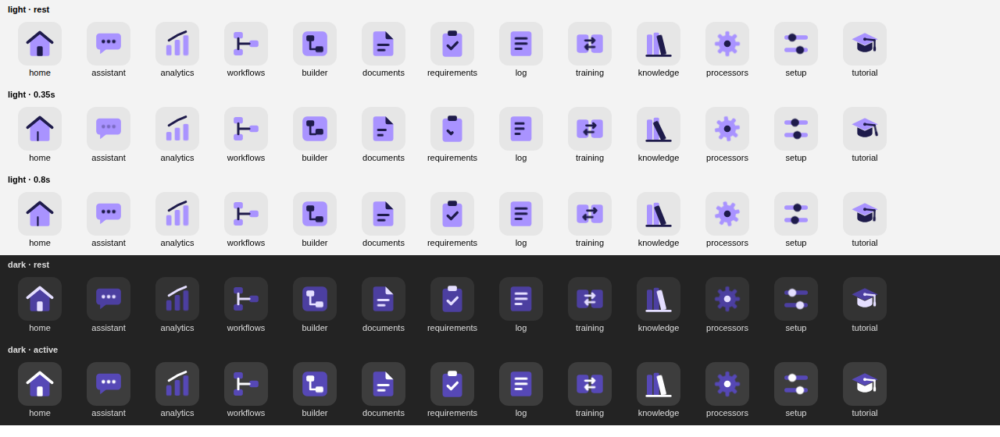

# Navigation (Frappe v16.54)

The app's place in the desk: its tile on the Apps screen, four dock buttons, a sidebar for each, and animated two-tone icons in the logo's colours. The dock's sparkles button, which opens the assistant panel, is a separate utility (docs/panel/entry-points.md); the section button is called Conversations so the two are not confused.

## Apps screen

`hooks.py` → `add_to_apps_screen`: the logo `public/images/frappe-intelligence-logo.svg`, opening `app_home` = `/desk/intelligence`, shown to users with the Intelligence User or Intelligence Agent role (`utils/access.can_use_assistant`). `app_logo_url` puts the same logo in the sidebar header and the app switcher.

## Dock and sidebars

| Dock button | Sidebar | Opens on | Items |
|---|---|---|---|
| Conversations | Intelligence | its Home workspace, `/desk/intelligence` | Home, Conversations, Session Analytics, Tutorial |
| Workflows | Intelligence Workflows | Workflow Builder | Workflow Builder, Workflows |
| Documents | Intelligence Documents | Document Templates | Document Templates, Document Requirements, Processing Log, Training Pairs |
| Setup | Intelligence Setup | AI Settings | AI Settings, Knowledge Packs, Post Processors |

A sidebar is a shell: its name is the first part of the URL (`/desk/intelligence-documents/ai-processing-log`), and each DocType opens in the one sidebar that lists it, so a list or form keeps its sidebar.

Only the Intelligence sidebar (the Conversations button) has a Home workspace. Frappe gives a sidebar every workspace of its module, and the first sidebar of the module answers for them (`sidebar.py`, `resolve_sidebar`; `sidebar.js`, `module_for_workspace`). All four sidebars belong to the Intelligence module, so a Home workspace on the others would open in the Intelligence shell.

The Home workspace has the shortcuts Tutorial, Conversations, Session Analytics, Knowledge Packs and AI Settings. Tutorial is a Page (`intelligence-tutorial`, [../tutorial/README.md](../tutorial/README.md)).

## Files

| Record | File |
|---|---|
| Dock | `dock/frappe_intelligence/frappe_intelligence.json` |
| Sidebars | `intelligence/sidebar/<name>/<name>.json` |
| Workspace | `intelligence/workspace/intelligence/intelligence.json` |
| Icons | `public/icons/module-icons.svg`, loaded by `app_include_icons` |

Change them in the desk on a developer-mode site (sidebar editor, Manage Dock), which writes these files, or edit the JSON and raise its `modified`, or migrate skips it. The old `workspace_sidebar/` and `desktop_icon/` records are gone: Frappe v16 reads the Dock and Sidebar records above.

## Icons

Each icon is a `<symbol id="icon-frappe_intelligence-<name>-duotone">`: a light violet body (`#A993FF`, `#4C3FA0` in dark mode) and a dark indigo detail (`#1E1B4B`, `#E4DEFF` in dark mode). One movement plays while its dock button is hovered.

| Icon | Used by | Movement |
|---|---|---|
| `home` | Home | the door opens |
| `assistant` | Conversations dock button and sidebar, Conversations | the dots type |
| `analytics` | Session Analytics | the bars grow |
| `workflows` | Workflows dock button and sidebar, Workflows | the branch is drawn |
| `builder` | Workflow Builder | a block lifts and snaps back |
| `documents` | Documents dock button and sidebar, Document Templates | the lines are written |
| `requirements` | Document Requirements | the tick is drawn |
| `log` | Processing Log | the lines are written |
| `training` | Training Pairs | the arrows swap |
| `knowledge` | Knowledge Packs | the book tips out |
| `processors` | Post Processors | the gear turns |
| `setup` | Setup dock button and sidebar, AI Settings | the knobs slide |
| `tutorial` | Tutorial | the tassel swings |

Drawn and checked with the `frappe-desk-icons` skill (`check_sprite.py`, `preview.py`).
